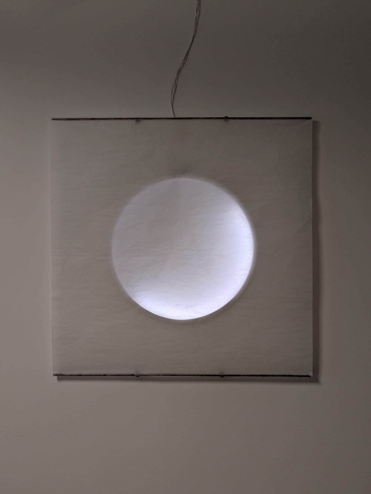
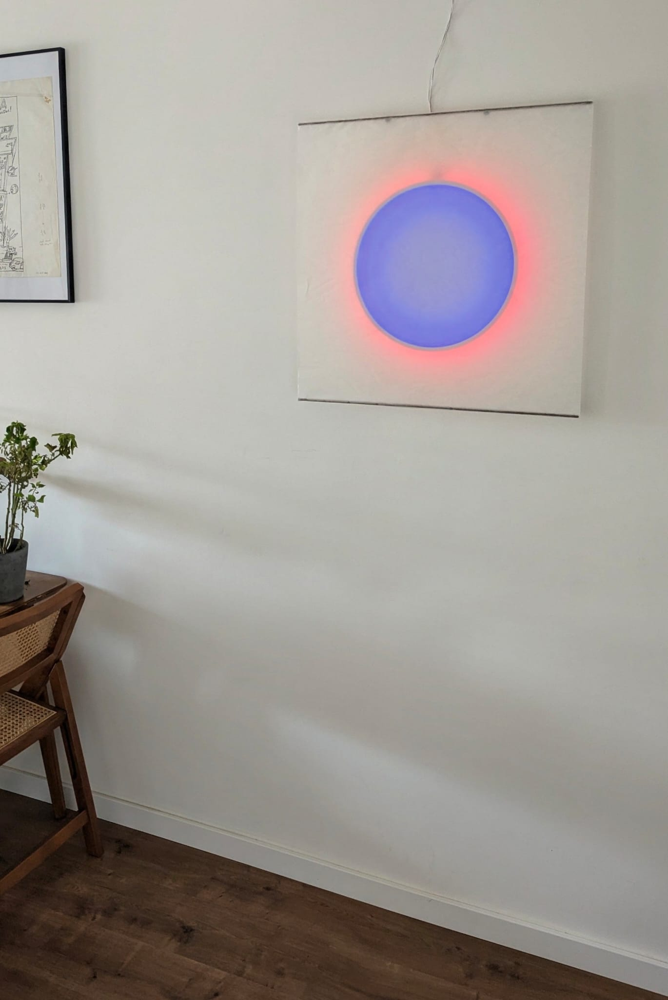
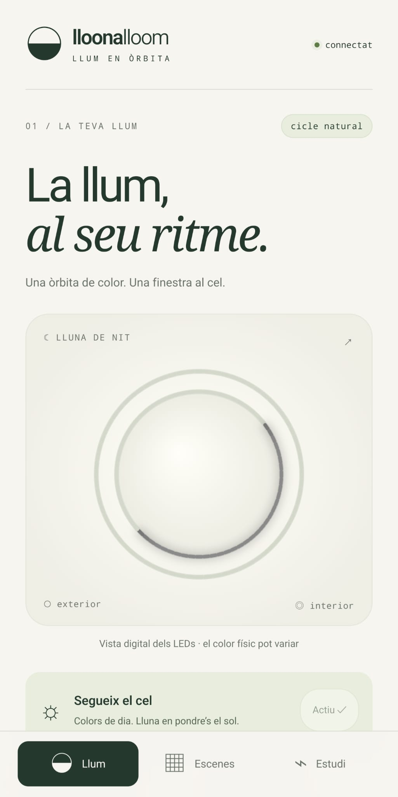
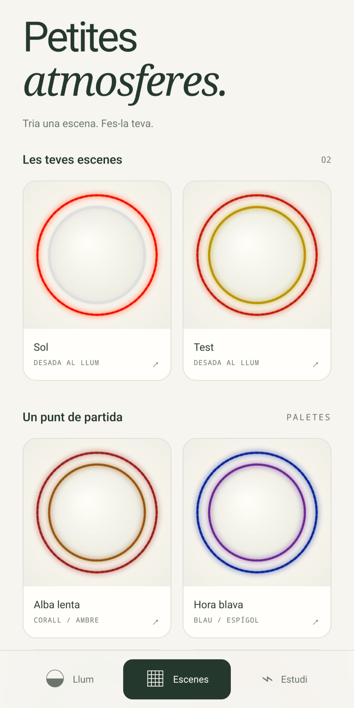
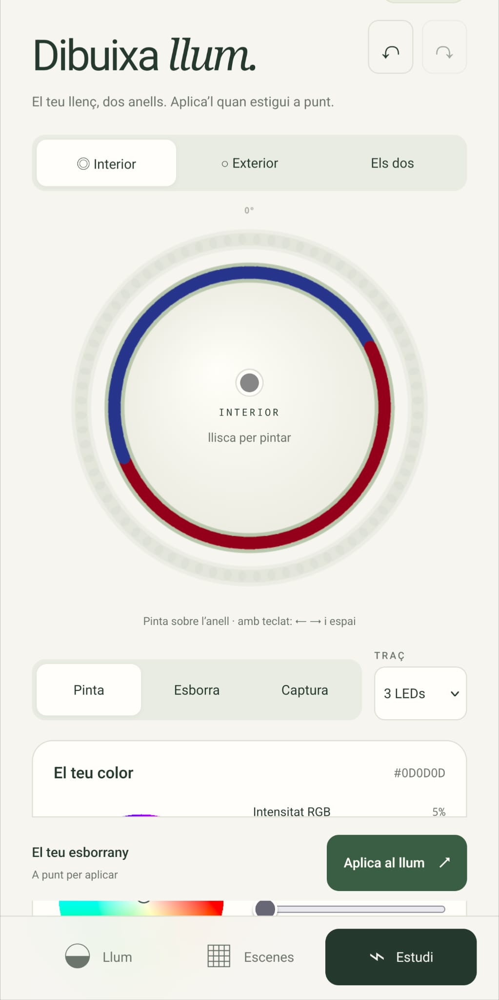

# Lloona-Lloom

**Un llum en òrbita: colors de dia, lluna de nit.**

Lloona-Lloom és un llum basat en **ESP32 i LEDs SK6812 RGBW** que interpreta el cicle del sol i de la lluna per a una ubicació concreta. Durant el dia combina colors; quan es fa de nit, representa la fase i l'orientació de la lluna amb llum blanca. Es programa amb **Arduino IDE** i es controla des del navegador del mòbil, a través d'una interfície web allotjada al mateix ESP32.

El projecte neix de la voluntat de tenir una lluna pròpia a casa: experimentar amb el color, programar atmosferes i seguir el cel que es veu per la finestra. La inspiració visual és [MOODMOON, de Sebastian Hepting per a Ingo Maurer (2021)](https://www.ingo-maurer.com/en/products/moodmoon/).

## El llum, en imatges

Fotografies del muntatge real: el mateix objecte explora la llum blanca reproduint la lluna a temps real i el contrast entre el centre i l'halo exterior.

<table>
  <tr>
    <td width="50%" align="center"><a href="img/photos/scene_1.jpeg"></a></td>
    <td width="50%" align="center"><a href="img/photos/scene_2.jpeg"></a></td>
  </tr>
  <tr>
    <td align="center"><strong>Llum blanca</strong><br>El cercle de llum sobre la superfície del llum.</td>
    <td align="center"><strong>Atmosfera de color</strong><br>Centre blau violaci i halo exterior coral.</td>
  </tr>
</table>

## Contingut

- [Què pot fer](#que-pot-fer)
- [Interfície web v2](#interficie-web-v2)
- [Maquinari](#maquinari)
- [Instal·lació amb Arduino IDE](#installacio-arduino)
- [Com funciona](#com-funciona)
- [Estructura del repositori](#estructura)
- [Desenvolupament i proves](#desenvolupament)
- [API i format de les escenes](#api)
- [Llicència](#llicencia)

<a id="que-pot-fer"></a>

## Què pot fer

| Mode | Comportament |
| --- | --- |
| **Cicle natural** | Sincronitza l'hora per NTP i calcula el cel per a les coordenades configurades. Colors diürns i lluna nocturna. |
| **Simulació** | Mostra el resultat d'una data i hora escollides, sense haver d'esperar que arribin. |
| **Manual** | Aplica escenes RGBW als dos anells, amb control per LED i efecte de foc opcional. |

Les escenes es poden desar a la memòria del dispositiu amb **LittleFS** i recuperar més endavant. El firmware també inclou actualitzacions per Wi-Fi amb **ArduinoOTA**.

<a id="interficie-web-v2"></a>

## Interfície web v2

La interfície està pensada per al mòbil vertical i s'adapta també a l'escriptori. Combina un fons marfil, verd fosc, titulars serif i dades monoespaiades. Les tres pestanyes separen el seguiment del llum, la biblioteca d'escenes i l'edició del color.

### Captures de pantalla

<table>
  <tr>
    <th width="33%">Llum</th>
    <th width="33%">Escenes</th>
    <th width="33%">Estudi</th>
  </tr>
  <tr>
    <td valign="top"><a href="img/screenshots/screenshot_1.jpeg"></a></td>
    <td valign="top"><a href="img/screenshots/screenshot_2.jpeg"></a></td>
    <td valign="top"><a href="img/screenshots/screenshot_3.jpeg"></a></td>
  </tr>
  <tr>
    <td valign="top">Consulta el llum i segueix el cicle natural.</td>
    <td valign="top">Recupera atmosferes o parteix d'una paleta.</td>
    <td valign="top">Dibuixa el color i aplica'l quan estigui a punt.</td>
  </tr>
</table>

Les imatges es poden obrir a mida completa fent-hi clic. Les captures mostren la distribució digital dels LEDs; les fotografies de la secció anterior mostren el resultat físic amb el material difusor.

### Llum: seguir el cel

Mostra l'estat dels dos anells, el mode actiu, la fase lunar i l'hora local. **«Segueix el cel»** reprèn el cicle automàtic. El formulari de simulació queda en un desplegable secundari: permet triar una data i una hora segons la zona horària del telèfon, indicada al mateix formulari. Les coordenades geogràfiques continuen sent les de `secrets.h`.

### Escenes: guardar atmosferes

La biblioteca llegeix les escenes desades a LittleFS i en mostra miniatures. Cada escena es pot ampliar, aplicar, editar o eliminar. Hi ha quatre paletes inicials per començar a experimentar; només ocupen memòria del dispositiu quan l'usuari les desa.

### Estudi: dibuixar llum

- Selecció de l'anell interior, l'exterior o tots dos.
- Pinzell d'1, 3 o 7 LEDs, goma i captura del color RGBW i de l'efecte de foc.
- Roda HSV, colors ràpids, intensitat RGB, canal blanc independent i entrada precisa.
- Desfer i refer fins a 30 passos; cada gest ocupa una entrada de l'historial.
- Traços interpolats, també quan travessen el punt de 0° de l'anell.
- Recuperació de l'últim esborrany al navegador amb `localStorage`, quan està disponible.

**Navegar, editar i desar no interromp el llum.** «Aplica al llum» envia l'escena completa i activa el mode manual. Desar escriu l'esborrany a LittleFS sense aplicar-lo abans. «Segueix el cel» retorna al funcionament automàtic.

La UI inclou controls tàctils amplis, focus visible, edició amb teclat i respecte per la preferència de moviment reduït. Utilitza fonts del sistema i no carrega scripts, fonts ni recursos d'Internet. La vista digital fa visibles els colors molt tènues, però no és una simulació fotomètrica ni una calibració del blanc. La crepitació de la vista ampliada és il·lustrativa; les miniatures són estàtiques.

<a id="maquinari"></a>

## Maquinari

La configuració del sketch actual és:

| Element | Configuració |
| --- | --- |
| Microcontrolador | ESP32 |
| LEDs | **144 SK6812 RGBW**, ordre `NEO_GRBW`, senyal a 800 kHz |
| Anell exterior | 72 LEDs, índexs físics 0–71 |
| Anell interior | 72 LEDs, índexs físics 72–143 |
| Pin de dades | **GPIO 27** |
| Alimentació dels LEDs | 5 V, amb font externa |
| Estructura | Perfil circular d'alumini i superfície difusora |

L'anell exterior crea l'atmosfera i l'interior representa l'astre. La capa d'abstracció del maquinari tradueix angles de 0° a 360° als LEDs físics i compensa el sentit de muntatge de l'anell interior.

La [llista de materials i les notes de muntatge](docs/BoM.md) detallen el controlador, l'alimentació, el cablejat i els elements de protecció.

<a id="installacio-arduino"></a>

## Instal·lació amb Arduino IDE

### 1. Preparar l'entorn

Instal·la el paquet de plaques **esp32 d'Espressif Systems** al gestor de plaques d'Arduino IDE i aquestes llibreries al gestor de biblioteques:

- **Adafruit NeoPixel**.
- **NTPClient**, de Fabrice Weinberg.
- **ArduinoJson**.

`WiFi`, `ESPmDNS`, `WiFiUdp`, `ArduinoOTA`, `WebServer` i `LittleFS` formen part del paquet ESP32.

La verificació de compilació documentada per a la v2 es va fer amb **ESP32 core 3.3.7**, **ArduinoJson 7.4.3** i **ESP32 Dev Module** (`esp32:esp32:esp32`). Aquestes són les versions de referència de la v2, no una exigència d'utilitzar les versions més recents.

### 2. Obrir el sketch i configurar les dades locals

Obre [lloonalloom/lloonalloom.ino](lloonalloom/lloonalloom.ino). Mantén el nom de la carpeta `lloonalloom/` igual que el del sketch, amb `webpage.h` i `web_api.h` al costat.

Copia [secrets.example.h](lloonalloom/secrets.example.h) a `lloonalloom/secrets.h` i introdueix-hi les dades de la teva xarxa i ubicació:

```cpp
#pragma once
#define SECRET_SSID "EL_TEU_WIFI"
#define SECRET_PASS "LA_TEVA_CONTRASENYA"
#define SECRET_DEVICE_NAME "Lloona-Lloom"
#define SECRET_LATITUDE 41.40
#define SECRET_LONGITUDE 2.18
```

Si ja tens un `secrets.h`, conserva'l. El `.gitignore` exclou aquest fitxer; `secrets.example.h` és la plantilla pública.

### 3. Compilar i carregar

1. Connecta l'ESP32 per USB i selecciona la placa i el port corresponents.
2. Si actualitzes un llum existent, conserva l'esquema de particions i mantén desactivada l'opció d'esborrar tota la flaix per preservar les escenes.
3. Compila i carrega el sketch des d'Arduino IDE.
4. Connecta el mòbil o l'ordinador a la mateixa xarxa Wi-Fi que l'ESP32.
5. Obre `http://<IP-del-dispositiu>/` al navegador. Pots consultar la IP assignada a la llista de dispositius del router.

**La interfície ja està incorporada a `webpage.h`, en PROGMEM.** Per carregar el firmware preparat no cal instal·lar Python ni Node.js, ni pujar fitxers web a LittleFS. LittleFS es reserva per a les escenes. La sincronització del rellotge es fa per NTP amb `pool.ntp.org` i necessita accés a la xarxa.

Després de la primera càrrega per USB, el firmware permet actualitzacions per Wi-Fi amb ArduinoOTA quan el port de xarxa està disponible a Arduino IDE.

<a id="com-funciona"></a>

## Com funciona

### Cicle solar i colors diürns

L'ESP32 obté l'hora UTC per NTP i calcula la posició solar per a la latitud i longitud configurades. El motor utilitza una aproximació basada en algorismes astronòmics de Jean Meeus. El canvi entre dia i nit fa servir una altitud solar de referència de −0,83°.

Durant el dia, cada anell rep un color de la paleta. La selecció és determinista: el dia julià ajustat a la longitud actua com a llavor aleatòria. Per això, un mateix dia conserva la parella de colors encara que es reiniciï el dispositiu. En mode natural, el càlcul es renova cada minut.

### Fase i orientació de la lluna

De nit, el motor calcula la fracció il·luminada i l'orientació del costat il·luminat, tenint en compte l'angle paral·làctic de l'observador. Això permet que la representació lunar canviï amb la data, l'hora i la ubicació.

El renderitzat projecta cada LED amb una funció cosinus i aplica una banda de suavitzat a la frontera entre llum i ombra. La lluna es dibuixa amb el canal blanc dedicat de la tira RGBW.

### Simulació i control manual

La simulació calcula un instant concret i el manté fins que es canvia de mode o de data. L'API admet dates entre **1970 i 2099**, amb el límit addicional de 2038 quan el core utilitza un `time_t` de 32 bits.

El mode manual aplica colors independents als dos anells i permet marcar LEDs amb efecte de foc. L'animació modula aquests LEDs a partir del seu color base. Les escenes desades persisteixen a LittleFS; el mode inicial del firmware és el cicle natural.

<a id="estructura"></a>

## Estructura del repositori

```text
.
├── README.md                 # Documentació principal del projecte i de la UI v2
├── LICENSE                   # Apache License 2.0
├── .gitignore                # Credencials, compilacions i fitxers locals
├── docs/
│   └── BoM.md                # Materials i notes de muntatge
├── img/
│   ├── photos/               # Fotografies del llum real
│   └── screenshots/          # Captures de la interfície web v2
└── lloonalloom/               # Carpeta del sketch d'Arduino
    ├── lloonalloom.ino        # Maquinari, astronomia, animació i bucle principal
    ├── secrets.example.h     # Plantilla pública de configuració
    ├── web_api.h             # Rutes HTTP, validació i persistència
    ├── webpage.h             # UI empaquetada en PROGMEM, inclosa al repositori
    ├── web/
    │   ├── index.html        # Estructura, textos i accessibilitat
    │   ├── style.css         # Disseny adaptable
    │   ├── core.js           # Colors, escenes i geometria del pinzell
    │   └── app.js            # Interacció, renderitzat i comunicació amb l'ESP32
    ├── tools/
    │   ├── build_web.py      # Empaquetat de la UI, sense dependències externes
    │   └── preview.py        # Demostració local amb API simulada
    └── tests/
        ├── core.test.cjs     # Proves de la lògica de la interfície
        └── browser.cjs       # Proves d'interacció amb Microsoft Edge
```

Les eines i les proves es mantenen al costat del sketch perquè utilitzen rutes relatives a `web/` i `.build/`. `webpage.h` es versiona perquè el projecte es pugui carregar directament amb Arduino IDE. Les credencials reals, els artefactes de compilació i les dependències locals queden fora de Git.

<a id="desenvolupament"></a>

## Desenvolupament i proves

Les ordres d'aquesta secció s'executen **des de `lloonalloom/`**:

```sh
cd lloonalloom
```

### Editar la interfície

Edita els fitxers de `web/` i regenera la capçalera amb Python 3:

```sh
python tools/build_web.py
```

Inclou tant les fonts de `web/` com el `webpage.h` regenerat al mateix commit.

### Previsualitzar sense ESP32

```sh
python tools/preview.py
```

Obre **http://127.0.0.1:8765**. La demostració serveix el mateix HTML que s'empaqueta per al firmware, amb dades simulades i escenes en memòria. No es connecta al llum físic; els canvis desapareixen en aturar el servidor.

### Verificar l'empaquetat i la lògica

Amb Python 3 i Node.js instal·lats, sense paquets addicionals:

```sh
python tools/build_web.py --check
node --test tests/core.test.cjs
```

### Proves al navegador

Amb Microsoft Edge instal·lat i la demostració en marxa, executa en un altre terminal, també des de `lloonalloom/`:

```sh
npm install --prefix .build/qa playwright-core
node tests/browser.cjs
```

La bateria cobreix el format RGBW/F, colors de baixa intensitat, traços al pas per 0°, historial, esborranys, desament sense aplicació, aplicació al llum, eliminació, simulació i recuperació d'errors de connexió. Les proves de navegador revisen amplades de 320, 390, 430 i 1024 píxels i deixen captures a `.build/qa/screenshots/`, una carpeta ignorada per Git.

La demostració i aquestes proves no substitueixen la verificació al dispositiu de l'orientació dels anells, el color RGBW físic, la persistència LittleFS i el canvi entre dia i nit.

<a id="api"></a>

## API i format de les escenes

<details>
<summary>Referència tècnica: rutes HTTP, persistència i compatibilitat</summary>

El servidor és **síncron**, basat en `WebServer`, i serveix la pàgina amb `send_P()` des de PROGMEM. El navegador serialitza les peticions, llegeix les miniatures d'una en una i consulta l'estat cada 15 segons. L'actualització periòdica s'atura quan la pàgina queda oculta. Les escriptures fallides no es reintenten automàticament.

| Ruta | Ús |
| --- | --- |
| `GET /api/status` | Mode, rellotge, dades lunars i sortida actual dels anells `ext`/`int`. |
| `POST /api/mode?set=astro` | Reprendre el cicle; `set=manual` aplica l'última escena manual. |
| `POST /api/simulate?ts=<epoch>` | Simular un instant UTC, expressat en segons Unix. |
| `POST /api/led` | Validar i aplicar `{ext,int}`, activant manual en una sola acció. |
| `GET /api/colors` | Llegir l'última escena manual en ordre visual. |
| `GET /api/presets/list` | Llistar els noms de les escenes, amb resposta per fragments. |
| `GET /api/presets/get?name=...` | Llegir una escena en ordre visual sense activar-la. |
| `POST /api/presets/save?name=...` | Desar `{ext,int}`; sense cos conserva el comportament antic. |
| `POST /api/presets/load?name=...` | Aplicar una escena desada; ruta conservada per compatibilitat. |
| `POST /api/presets/delete?name=...` | Eliminar una escena. |

Els noms s'han de codificar per a URL. Cada escena conserva el fitxer `p_<nom>.json` i els camps `name`, `ext` i `int`. Cada LED ocupa **9 caràcters `RRGGBBWWF`**: quatre canals en hexadecimal i un indicador de foc (`0` o `1`). Cada anell de 72 LEDs ocupa, per tant, 648 caràcters.

Els fitxers a LittleFS utilitzen l'ordre físic dels LEDs; l'API converteix entre aquest ordre i l'ordre visual de la UI. Les escenes compatibles amb aquest format no necessiten migració. El desament escriu primer un fitxer temporal i el reanomena en acabar.

Tots dos anells es validen abans d'aplicar canvis. Els noms es serialitzen com a JSON i es mostren amb `textContent`; les col·lisions entre noms amb espais i guions baixos es rebutgen si corresponen a una altra escena.

La UI v2 s'ha de carregar amb el firmware que l'acompanya: `/api/led` aplica l'escena sense demanar un canvi previ a manual, i `/api/simulate` activa la simulació quan rep una data vàlida.

</details>

<a id="llicencia"></a>

## Llicència

Projecte distribuït sota la [llicència Apache 2.0](LICENSE).
