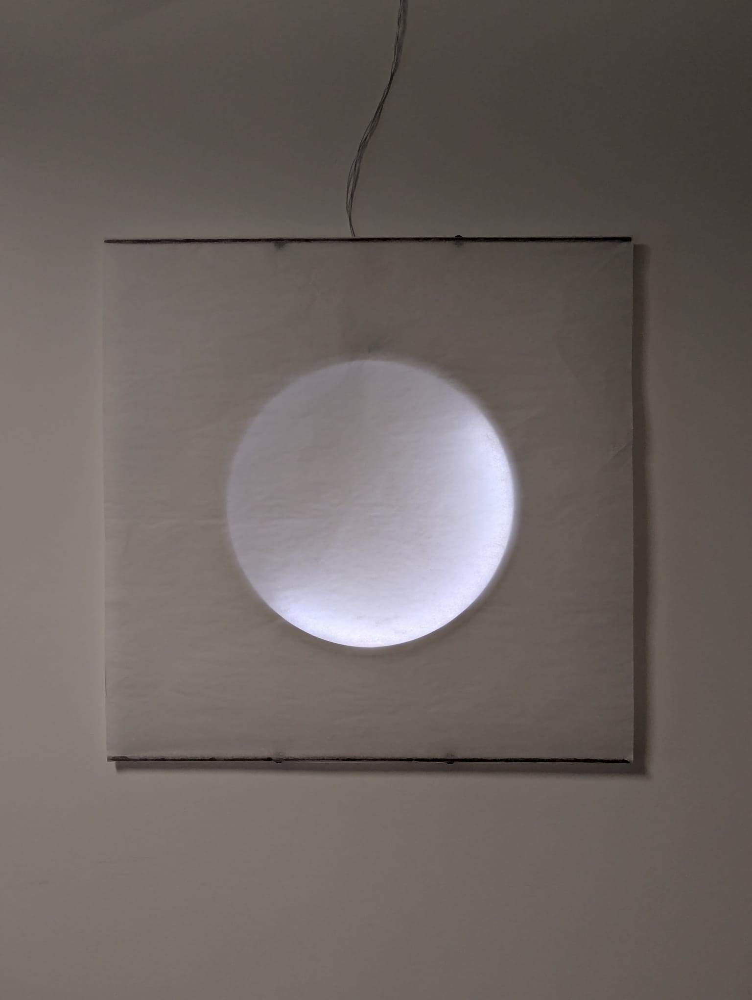
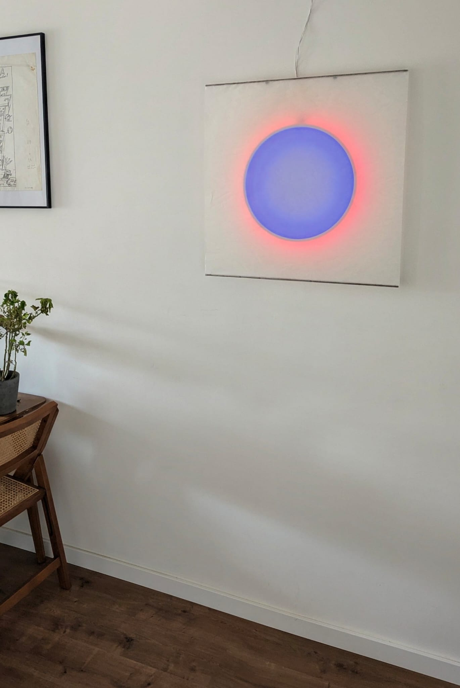
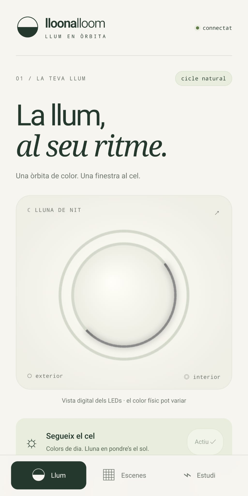
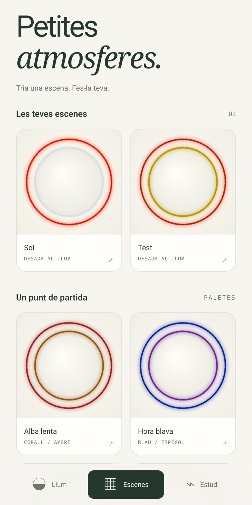
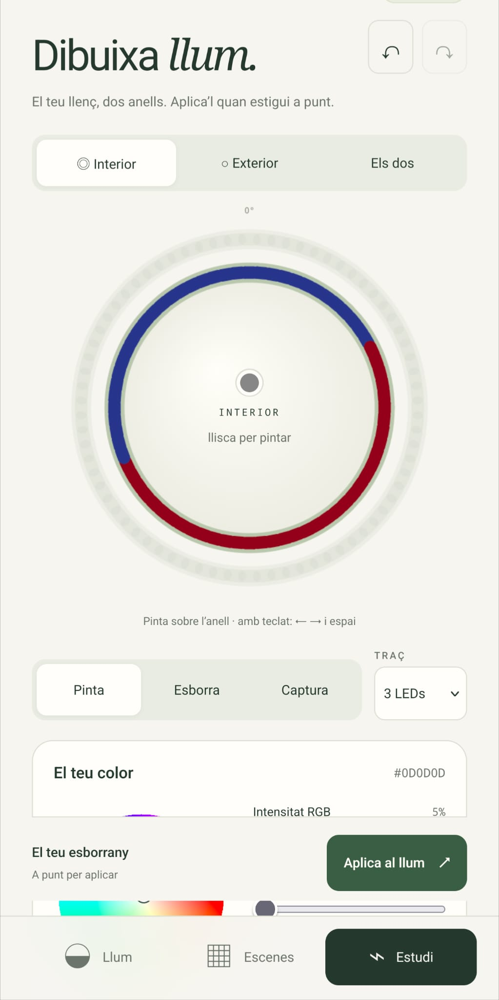

# Lloona-Lloom

**Un llum en òrbita: colors de dia, lluna de nit.**

Lloona-Lloom és un llum basat en **ESP32 i LEDs SK6812 RGBW** que interpreta el cicle del sol i de la lluna per a una ubicació concreta. Durant el dia combina parelles harmòniques de color; quan es fa de nit, representa la fase i l'orientació de la lluna amb llum blanca. El firmware es programa amb **Arduino IDE** i la interfície completa de control s'integra dins de **Home Assistant**, mentre l'ESP32 manté tota la lògica astronòmica local i una pàgina web lleugera de manteniment.

El projecte neix de la voluntat de tenir una lluna pròpia a casa: experimentar amb el color, programar atmosferes i seguir el cel que es veu per la finestra. La inspiració visual és [MOODMOON, de Sebastian Hepting per a Ingo Maurer (2021)](https://www.ingo-maurer.com/en/products/moodmoon/).

## El llum, en imatges

Fotografies del muntatge real: el mateix objecte explora la llum blanca reproduint la lluna a temps real i el contrast entre el centre i l'halo exterior.

<!-- Amplades proporcionals a una altura de 360 px: GitHub pot recalcular height amb height:auto. -->
<p align="center">
  <a href="img/photos/scene_1.jpeg"></a>
  <a href="img/photos/scene_2.jpeg"></a>
</p>

**Llum blanca:** el cercle de llum sobre la superfície del llum. **Atmosfera de color:** centre blau violaci i halo exterior coral. Fotografies en aquest ordre.

## Contingut

- [Què pot fer](#que-pot-fer)
- [Interfície i integració amb Home Assistant](#interficie-ha)
- [Maquinari](#maquinari)
- [Instal·lació amb Arduino IDE](#installacio-arduino)
- [Com funciona](#com-funciona)
- [Estructura del repositori](#estructura)
- [API i format de les escenes](#api)
- [Llicència](#llicencia)

<a id="que-pot-fer"></a>

## Què pot fer

| Mode | Comportament |
| --- | --- |
| **Cicle natural** | Sincronitza l'hora per NTP i calcula el cel per a les coordenades configurades. Parelles diürnes harmòniques i lluna nocturna. |
| **Simulació** | Mostra el resultat d'una data i hora escollides, sense haver d'esperar que arribin. |
| **Manual** | Aplica escenes RGBW als dos anells, amb control per LED i efecte de foc opcional. |
| **Calibració** | Emet 27 mostres de referència per anell (una sola corona activa alhora) per ajustar la paleta diürna des de Home Assistant. |

L'encesa i l'apagat del llum (`power`) funcionen de manera independent del mode actiu. L'estat d'execució, les escenes guardades, la variació del dia i la paleta diürna calibrada es desen a **LittleFS**, de manera que el dispositiu continua sent autònom fins i tot sense connexió amb el servidor. El firmware també inclou actualitzacions per Wi-Fi amb **ArduinoOTA**.

<a id="interficie-ha"></a>

## Interfície i integració amb Home Assistant

La interfície completa d'usuari —el seguiment del cel, la biblioteca d'escenes, l'estudi de dibuix LED i l'assistent de calibració— ara viu integrada dins de **Home Assistant**, que es comunica amb l'ESP32 mitjançant la seva API HTTP versionada (`/api/v1`) i en comprova periòdicament les capacitats.

### Captures de pantalla

Mostra visual de les tres vistes principals de la interfície integrada:

<!-- Amplades proporcionals a una altura de 480 px, sense columnes que comprimeixin les imatges. -->
<p align="center">
  <a href="img/screenshots/screenshot_1.jpeg"></a>
  <a href="img/screenshots/screenshot_2.jpeg"></a>
  <a href="img/screenshots/screenshot_3.jpeg"></a>
</p>

**Llum · Escenes · Estudi**, en aquest ordre: seguir el cicle natural, recuperar atmosferes i dibuixar el color.

Les imatges es poden obrir a mida completa fent-hi clic. Les captures mostren la distribució digital dels LEDs; les fotografies de la secció anterior mostren el resultat físic amb el material difusor.

### Llum: seguir el cel

Mostra l'estat real dels dos anells, el mode actiu, l'encesa/apagat, la fase lunar i l'hora local. Permet reprendre el cicle automàtic, canviar la parella diürna del dia actual sense esperar a l'endemà, fer una previsualització de lectura o activar la simulació per a una data i hora concretes.

### Escenes: guardar atmosferes

La biblioteca llegeix les escenes desades a LittleFS de l'ESP32 i en mostra miniatures. Cada escena es pot aplicar, editar o eliminar, amb protecció d'escriptura atòmica i sense interrompre el llum mentre es navega o es desa un esborrany.

### Estudi: dibuixar llum

Editor per pintar l'anell interior, l'exterior o tots dos amb control per LED dels quatre canals RGBW i de l'efecte de foc individual, respectant el límit de potència manual del firmware.

### Calibració i web local de manteniment

Home Assistant incorpora també el flux de calibració colorimètrica per anell i envia al dispositiu la taula diürna calibrada resultant, que queda desada a LittleFS.

A l'adreça `http://<IP-del-dispositiu>/`, l'ESP32 continua servint directament des de la memòria flash (`PROGMEM`) una **pantalla curta de manteniment** amb autenticació opcional per clau. Aquesta web local permet encendre o apagar el llum, tornar al mode astronòmic a temps real, aturar una calibració en curs i consultar l'estat bàsic encara que Home Assistant no estigui disponible.

<a id="maquinari"></a>

## Maquinari

La configuració del sketch actual és:

| Element | Configuració |
| --- | --- |
| Microcontrolador | ESP32 |
| LEDs | **144 SK6812 RGBW**, ordre `NEO_GRBW`, senyal a 800 kHz |
| Anell exterior | 72 LEDs, índexs físics 0–71 |
| Anell interior | 72 LEDs, índexs físics 72–143 |
| Pin de dades | **GPIO 27** |
| Alimentació dels LEDs | 5 V, amb font externa |
| Estructura | Perfil circular d'alumini i superfície difusora |

L'anell exterior crea l'atmosfera i l'interior representa l'astre. La capa d'abstracció del maquinari tradueix angles de 0° a 360° als LEDs físics i compensa el sentit de muntatge de l'anell interior.

La [llista de materials i les notes de muntatge](docs/BoM.md) detallen el controlador, l'alimentació, el cablejat i els elements de protecció. Durant la calibració, un sol anell pot assolir una suma RGBW de fins a 255 per LED; cal assegurar que la font i el cablejat estiguin dimensionats adequadament.

<a id="installacio-arduino"></a>

## Instal·lació amb Arduino IDE

### 1. Preparar l'entorn

Instal·la el paquet de plaques **esp32 d'Espressif Systems** al gestor de plaques d'Arduino IDE i aquestes llibreries al gestor de biblioteques. Les versions comprovades al perfil [sketch.yaml](lloonalloom/sketch.yaml) per al firmware **1.1.1** són:

- **esp32** (Espressif Systems): **3.3.2**
- **Adafruit NeoPixel**: **1.12.5**
- **NTPClient** (Fabrice Weinberg): **3.2.1**
- **ArduinoJson**: **6.21.5** *(selecciona expressament la branca 6)*

`WiFi`, `ESPmDNS`, `WiFiUdp`, `ArduinoOTA`, `WebServer`, `LittleFS` i `mbedtls` formen part del paquet ESP32. El perfil de compilació verificat és **ESP32 Dev Module** (`esp32:esp32:esp32`).

### 2. Obrir el sketch i configurar `secrets.h`

Obre [lloonalloom/lloonalloom.ino](lloonalloom/lloonalloom.ino). Mantén dins de la mateixa carpeta `lloonalloom/` tots els fitxers `.h` del projecte (`types.h`, `api_support.h`, `day_palette.h`, `webpage.h` i `secrets.h`); l'IDE els carregarà com a pestanyes.

Copia [secrets.example.h](lloonalloom/secrets.example.h) a `lloonalloom/secrets.h` i introdueix-hi les teves dades locals:

```cpp
#pragma once
#define SECRET_SSID "wifi-name"
#define SECRET_PASS "wifi-password"
#define SECRET_DEVICE_NAME "lloona"
#define SECRET_LATITUDE 41.4
#define SECRET_LONGITUDE 2.17
// Token Bearer opcional per protegir l'API; posa el mateix valor a Home Assistant.
#define SECRET_API_TOKEN ""
// OTA activa per defecte. Omple la contrasenya abans de compilar.
// Posa false només si tries expressament actualitzacions només per USB.
#define SECRET_ENABLE_OTA true
#define SECRET_OTA_PASSWORD ""
```

Notes sobre configuració i seguretat:

- **`SECRET_API_TOKEN`**: és opcional. Si li dones un valor, totes les rutes `/api` i `/api/v1` exigiran la capçalera `Authorization: Bearer <token>` i hauràs de configurar el mateix valor a la integració de Home Assistant. Si queda buit, l'API accepta peticions a la xarxa local sense token.
- **`SECRET_OTA_PASSWORD` i `SECRET_ENABLE_OTA`**: l'OTA queda habilitada per defecte. Si `SECRET_ENABLE_OTA` és `true` i `SECRET_OTA_PASSWORD` és buit o absent (per exemple en reutilitzar un `secrets.h` antic), la compilació s'atura amb un `static_assert` explícit per evitar perdre accidentalment les càrregues per Wi-Fi. Només si vols desactivar l'OTA expressament, defineix `#define SECRET_ENABLE_OTA false` (aleshores caldrà USB per actualitzar).
- **Secrets fora de Git**: el `.gitignore` únic de l'arrel exclou `secrets.h` i qualsevol variant `*secrets*.h` (conservant només `secrets.example.h`). Si un `secrets.h` ja s'hagués afegit alguna vegada a l'índex de Git, `.gitignore` no el deixa de seguir automàticament; cal retirar-lo de l'índex sense esborrar el fitxer local amb `git rm --cached -- lloonalloom/secrets.h`.

### 3. Verificar i carregar

1. Connecta l'ESP32 per USB (o selecciona el port de xarxa OTA si ja hi ha un firmware amb OTA escoltant) i tria la placa i l'esquema de particions habituals.
2. **Conserva la partició LittleFS**: en actualitzar un llum existent, mantén l'esquema de particions i **no activis** l'esborrat complet de la flash ni formatis LittleFS, ja que les escenes i la paleta diürna calibrada viuen en aquesta partició.
3. Prem **Verifica**. Com a referència, el firmware ocupa aproximadament **1,10 MB** de programa i **52,6 kB** de variables globals; assegura't que la partició d'aplicació té prou espai sense alterar la partició de dades.
4. Prem **Carrega**. Un cop reiniciat, comprova que el dispositiu es reconnecta a la Wi-Fi (`pool.ntp.org` requereix accés a Internet per sincronitzar l'hora per NTP).
5. Connecta'l des de **Home Assistant** (o espera que la integració en detecti les noves capacitats via `/api/v1/info`), o bé comprova l'estat bàsic a `http://<IP-del-dispositiu>/`.

> **Si un firmware instal·lat prèviament no escolta OTA:** la contrasenya OTA només funciona quan el receptor OTA ja està actiu al dispositiu. Si l'ESP32 rebutja el port UDP `3232`, caldrà una primera càrrega puntual per USB (mantenint desactivat l'esborrat complet de la flash per conservar LittleFS).

<a id="com-funciona"></a>

## Com funciona

### Cicle solar i parelles diürnes harmòniques

L'ESP32 obté l'hora UTC per NTP i calcula la posició solar per a la latitud i longitud configurades mitjançant algorismes astronòmics basats en Jean Meeus. El canvi entre dia i nit utilitza una altitud solar de referència de **−0,83°**.

Durant el dia, en lloc de triar dos colors independents, el sistema selecciona una de les **8 parelles harmòniques** predefinides (`DAY_PAIR_INDICES`). La selecció és determinista a partir del dia julià ajustat a la longitud (`mix32`) i alterna la paritat per evitar repetir la mateixa parella en dos dies consecutius. Si es vol canviar la combinació del dia actual, `/api/v1/day/new` incrementa una variant que es desa a `/day_state.json`.

Quan Home Assistant envia una paleta diürna calibrada (`POST /api/v1/day/palette`), aquesta taula de 8 parelles es desa a `/day-palette-v1.json` (amb cada canal en un rang `0..10` i suma per LED ≤ 10 per preservar el nivell diürn suau) i el motor astronòmic l'adopta localment fins i tot després de reiniciar.

### Fase i orientació de la lluna

De nit, el motor calcula la fracció il·luminada a partir de l'elongació aparent real Sol-Lluna i determina l'orientació del costat il·luminat tenint en compte l'angle paral·làctic de l'observador.

El renderitzat projecta cada LED amb una funció cosinus sobre el canal blanc dedicat (`MAX_MOON_BRIGHTNESS = 15`), amb ajustos específics per al difusor físic:

- **Lluna nova realment apagada**: si la fracció il·luminada és `<= 0,001`, tots els LEDs queden a zero.
- **Atenuació de creixents i minvants fins**: per sota del `25 %` d'il·luminació, la brillantor màxima s'escala progressivament entre el `35 %` i el `100 %` perquè la difusió física no ompli el centre del disc.
- **Reducció del suavitzat prop de lluna nova**: per sota del `8 %`, la banda de transició entre llum i ombra s'estreny proporcionalment per evitar llum residual.

### Simulació, control manual i persistència

- **Previsualització i simulació**: `/api/v1/preview` permet consultar els càlculs d'una data sense alterar els LEDs ni el mode; `/api/v1/simulate` aplica l'instant demanat. L'API accepta marques de temps Unix entre els anys **2000 i 2100** (`946684800`–`4102444800`, amb el límit de 2038 quan el core utilitza `time_t` de 32 bits).
- **Límit de potència manual**: cada LED en mode manual passa per `clampManualColor` perquè la suma `R + G + B + W` no superi mai `MANUAL_MAX_TOTAL = 48`. Els LEDs marcats amb el flag de foc (`f = 1`) modulen dinàmicament el seu color base.
- **Persistència i concurrència**: els canvis d'estat (mode, encès/apagat, simulació i darrer disseny manual) es desen de manera diferida a `/runtime-v1.json` a LittleFS. L'API utilitza sessions temporals (`X-Lloona-Session`, vigència de 120 segons) i revisions optimistes (`If-Match`) per evitar que dues pantalles se sobreescriguin alhora.

### Calibració colorimètrica

El mode `MODE_CALIBRATION` recorre **27 mostres fixes** definides al firmware (`FONS`, primaris `R/G/B/W` al 40 %, 70 % i 100 %, barreges dobles/triples/quàdruples i mostres de validació `VAL-A`, `VAL-B` i `VAL-C`). Només s'il·lumina un anell alhora (`inner` o `outer`) amb un límit de seguretat `R + G + B + W <= 255` per LED. En finalitzar —o automàticament després de **30 minuts d'inactivitat**— el firmware restaura el mode i els píxels anteriors.

<a id="estructura"></a>

## Estructura del repositori

```text
.
├── README.md                 # Documentació principal del projecte i firmware
├── LICENSE                   # Apache License 2.0
├── .gitignore                # Regles globals d'exclusió (secrets, compilacions i sistema)
├── docs/
│   └── BoM.md                # Llista de materials i notes de muntatge
├── img/
│   ├── photos/               # Fotografies del llum real
│   └── screenshots/          # Captures de la interfície integrada
└── lloonalloom/              # Carpeta del sketch d'Arduino
    ├── lloonalloom.ino       # Maquinari, motor astronòmic, calibració, animació i servidor HTTP
    ├── types.h               # Estructures de dades i enumeració de modes
    ├── api_support.h         # Versionat /api/v1, autenticació, sessions, power i persistència
    ├── day_palette.h         # Validació i persistència de la paleta diürna calibrada
    ├── webpage.h             # Web local curta de manteniment en PROGMEM
    ├── secrets.example.h     # Plantilla pública de configuració (copiar a secrets.h)
    └── sketch.yaml           # Perfil de placa, core ESP32 i versions de llibreries
```

Les credencials reals (`lloonalloom/secrets.h`), els fitxers comprimits (`*.zip`) i els artefactes de compilació locals queden exclosos pel `.gitignore` de l'arrel.

<a id="api"></a>

## API i format de les escenes

<details>
<summary>Referència tècnica: API v1, sessions, persistència i format d'escenes</summary>

El servidor HTTP és **síncron**, basat en `WebServer`, i serveix la pàgina de manteniment amb `send_P()` des de PROGMEM. Totes les rutes d'API estan exposades sota `/api/v1/...` i conserven l'àlies `/api/...` per compatibilitat.

- **Autenticació opcional**: si `SECRET_API_TOKEN` no és buit, cal enviar `Authorization: Bearer <token>`.
- **Sessions i concurrència**: les operacions d'escriptura o canvi d'estat exigeixen la capçalera `X-Lloona-Session` (identificador alfanumèric amb `-` o `_`, fins a 80 caràcters, bloqueig exclusiu durant 120 segons) i admeten `If-Match: <revision>` per detectar conflictes. Les rutes d'emergència (`POST /api/v1/calibration/stop` i `POST /api/v1/power` amb `{"on":false}`) es permeten sense bloqueig de sessió.

| Ruta | Ús |
| --- | --- |
| `GET /api/v1/info` | Versió d'API i firmware (`1.1.1`), MAC del dispositiu i mapa de capacitats. |
| `POST /api/v1/session` | Reclamar la sessió de control o alliberar-la (`{"release":true}`). |
| `POST /api/v1/power` | Encendre o apagar la sortida LED (`{"on":true\|false}`) sense perdre el mode. |
| `GET /api/v1/status` | Estat complet: versió, `boot_id`, `revision`, `power`, rellotge, anells `ext`/`int`, mode, dades lunars i parella del dia. |
| `GET /api/v1/preview?ts=<epoch>` | Previsualització astronòmica i de parella diürna de lectura, sense modificar els LEDs. |
| `POST /api/v1/mode?set=astro\|manual` | Canviar entre el cicle astronòmic i l'última escena manual. |
| `POST /api/v1/simulate?ts=<epoch>` | Simular un instant UTC (`946684800`–`4102444800`). |
| `POST /api/v1/day/new` | Passar a la següent variant de parella diürna per al dia actual i desar-la a `/day_state.json`. |
| `GET /api/v1/day/palette` | Llegir la signatura (64 caràcters hexadecimals) i el recompte de la paleta diürna activa. |
| `POST /api/v1/day/palette` | Validar i desar a `/day-palette-v1.json` les 8 parelles diürnes calibrades. |
| `POST /api/v1/led` | Validar, limitar (`MANUAL_MAX_TOTAL = 48`) i aplicar `{ext,int}` en mode manual. |
| `GET /api/v1/colors` | Llegir l'última escena manual en ordre visual. |
| `GET /api/v1/presets/list` | Llistar els noms de les escenes desades. |
| `GET /api/v1/presets/get?name=...` | Llegir una escena en ordre visual sense aplicar-la. |
| `POST /api/v1/presets/save?name=...` | Desar `{ext,int}` (o l'estat manual actual si s'envia sense cos). |
| `POST /api/v1/presets/load?name=...` | Aplicar una escena desada en mode manual. |
| `POST /api/v1/presets/delete?name=...` | Eliminar una escena. |
| `GET /api/v1/calibration/samples` | Llistar les 27 mostres immutables de calibració. |
| `GET /api/v1/calibration/status` | Estat actual del mode de calibració (`active`, `ring`, `index`, `count`, `sample`). |
| `POST /api/v1/calibration/start?ring=inner\|outer` | Iniciar la calibració en un anell (requereix el llum encès). |
| `POST /api/v1/calibration/step?index=<0..26>` | Mostrar la mostra indicada a l'anell seleccionat. |
| `POST /api/v1/calibration/stop` | Aturar la calibració i restaurar l'estat previ. |

Els noms d'escena s'han de codificar per a URL (màxim 20 caràcters Unicode i 80 bytes, sense `/` ni `\`). Cada LED ocupa **9 caràcters `RRGGBBWWF`**: quatre canals en hexadecimal i un indicador de foc (`0` o `1`). Cada anell de 72 LEDs ocupa, per tant, 648 caràcters.

Els fitxers nous s'emmagatzemen atòmicament a LittleFS amb nom `p_<sha256_prefix>.json` per evitar col·lisions entre noms, mantenint compatibilitat de lectura, actualització i esborrat amb els fitxers antics `p_<nom>.json`. L'API converteix automàticament entre l'ordre físic dels LEDs i l'ordre visual de la interfície.

</details>

<a id="llicencia"></a>

## Llicència

Projecte distribuït sota la [llicència Apache 2.0](LICENSE).
